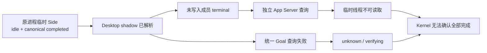

# Side 终态与成员资格修复：诊断与验收

当前结论（2026-10-14）：三段修复均已交付，当前包于11:23实际加载；固定轮次11:30:30直接从 running 进入 completed，未读包57获 applied ACK，随后20次原生样本在90.929秒内保持 completed/idle/unread。该窗口未见 stopped 过渡或完成后反弹；相位归属仍是匿名日志时间/发布链关联，没有结束后截图。完整结果与未覆盖边界由[任务卡 V-39–V-45](task-card.md#2026-10-14-1133-新包固定结束窗口验收结果)统一登记。

以下第1–4节保留2026-10-13 21:36的旧源码诊断，当时结论为 **diagnosed / not implemented / host still failing**。其中源码行号、待实施边界与现场状态只适用于该历史阶段；当前实现和验收以任务卡及第6节为准。

## 1. 现场事实

| 对象 | 直接证据 | 结论边界 |
| --- | --- | --- |
| 当前插件 | 20:32:26 产物在 20:48:03.309 精确 host-loaded，Host/Renderer 与期望一致；现场搜索目标仍 unknown/sub+3，归档禁用 | 不是仅凭构建结果推测已加载；当前仍未修好 |
| 主任务 | 原进程 IPC 21:34:45.142：ephemeral=false，runtime idle，requests 0，overlay 0，最新 canonical completed，startedAt=1791889935587，threadGoal 显式 null | 主任务有直接完成证据 |
| 目标 Desktop Side | 原进程 IPC 21:34:45.161：ephemeral=true、sideConversation=true、父关系一致，runtime idle，requests 0，overlay 0，最新 canonical completed，startedAt=1791889938275；没有 threadGoal 字段 | 该成员的完成回合是真实原进程数据；字段缺失不能自行解释成 Goal none |
| 临时 Side 的持久化查询 | 独立 App Server：thread/read 与 thread/turns/list 均返回 -32600/thread not loaded；thread/goal/get 返回 -32600/thread not found。桌面原进程工具明确报告 ephemeral threads do not support thread/turns/list | 跨进程能力不适用，不能解释为 Side 删除或完成 |
| 其他机器成员 | 按生产发现规则对最近至多 24 个候选只读 thread/read，当前两名原生 parentThreadId 指向目标根的成员，latest 均 completed、Goal 均 null；较早显式 spawn 子代理另行核得 completed/Goal null | 当前发现范围有界；不把较早子代理与当前 sub 数机械一一对应 |
| 匿名根日志 | 20:58:02.896/08.041：branchSource=private、branchCount=4、sideKnownCount=3、read bridge connected、全部已读。此前 20:48 为 5/4 | 与后续 UI sub+3 相符；日志中的 unreadKnown 不能证明成员终态已接纳 |

所有现场读取仅提取身份关联、状态、时间和计数；没有输出或持久化会话正文、凭据或原始 IPC 帧。原进程定向订阅在取样后解除。没有打开目标会话、改已读、手动完成或删除关系；结束时实际浮窗已收起。

## 2. 与现场吻合的代码缺口：临时线程被送入持久化查询路径

1. `preload/codex/desktop-shadow.cjs:192–195,224–226` 已解析 canonical history，保存 `currentCanonicalTurn={turnRef,status,startedAt}`。这名 Side 的 completed 并非完全没被解析。
2. `preload/index.js` 对 currentCanonicalTurn 的使用集中于问题/运行判定、定向查询 baseline 和 turnStartedAt。没有把该成员自己的 canonical completed 写入 `codexPrivateBranchTerminals`；shadow 同时未保留 `ephemeral` 或 `threadGoal` 的来源能力信息。
3. `verifyUncorroboratedActiveSnapshot`（5315 起）将无终态的 idle Side 交给 `scheduleLatestTurnRefresh`，后者仍调用独立 App Server `thread/turns/list`（5659 起）。这个调用不能核验原进程的 ephemeral Side；错误被 catch 吞掉，终态账本保持缺失。
4. `codexRememberDesktopSideRelation`（4431）又对所有 Side 统一调用 `thread/goal/get`。临时线程在该进程查不到 Goal，缓存进入 unknown/verifying。
5. `evidence-adapter-v7.cjs:119–139` 把 Goal verifying 转成 unknown 候选；`task-kernel.cjs:371–375` 的 goal-verifying 优先级 5 高于 terminal 的 3。因此只补成员 terminal 仍不足以收口，必须同时选对 Goal 来源或核实能力合同。

原源码临时复现与现场形状一致：canonical completed、overlay 空、runtime idle、requests 空，Side RPC 失败。结果为 currentCanonicalTurn 保留 completed，但成员 private terminal 缺失、Goal unknown/verifying、Kernel unknown；Turn 查询 6 次、Goal 1 次。该测试断言缺陷存在，**不是修复后验收**。

历史复现使用未入库的本机临时夹具（1项）；当前对应的持续回归是[临时Side自身完成与未读保留](../../../../tests/platform/codexAppServerBridge.test.ts#L11180)，不将临时路径作为仓库复现入口。

## 3. 旧数据与代码错误分别判断

### 3.1 持久化关系不是已证明的垃圾数据

- 对 uTools 数据库仅制作一致性检查通过的临时副本，读取精确 Side 关系文档及其两个可用修订；未写原数据库，副本随即清理。
- winning 修订 335 的全局关系数为 3，其中一条属于目标根，行 observedAt 为 20:48:11.997；整表 updatedAt 为 20:49:15.315。updatedAt 是整表落盘时间，不是关系首次建立时间。
- 非 winning 修订 181 不含目标关系，不能据修订冲突断言本故障来自旧缓存覆盖。
- 目标关系虽在 SQLite 线程表中不存在，但原进程明确证明它是仍可读取的 ephemeral Side，且当前父关系吻合。因此不能按数据库缺失、RPC notFound、TTL 或父完成来清掉它。
- 新关系入口取 `params.conversationId`，父关系来自原生 fork/navigation 元数据；未发现 turnId/requestId 被写进关系表。临时独立身份夹具也未复现这种混用。

### 3.2 独立缺陷 A：Goal 首次失败后失去重试入口

`refreshCodexThreadGoal` 本身有 fresh、30 秒 retryAt、inflight 去重保护（3860 起），但记关系处只在 `!cache.has(threadId)` 时调用。第一次失败已经写入缓存，后续 snapshot 被 has 判定挡住；库存 Goal 扫描又只覆盖 eligibleRows，不含 Desktop-only Side。

原源码复现：首次 Goal 失败、成员 latest-Turn completed；推进 37.2 秒、重放 snapshot 并执行现有库存扫描后，Goal 请求仍只有 1 次，根仍 unknown。临时仅移除错误的 has 门槛、保留 reader 自身节流后，第二次查询可成功并收口。此修正只解决可读取的成员，不能修好不支持该 RPC 的 ephemeral。

原源码证据来自未入库的本机临时夹具；当前对应的持续回归是[普通Side Goal失败后的既有冷却重试](../../../../tests/platform/codexAppServerBridge.test.ts#L11307)。另一个恢复 hint 无 shadow 的夹具表明：只恢复关系并不自动获得状态证据；metadata 失败后普通扫描也不重试，不能把这种失败作为清退依据。

### 3.3 独立缺陷 B：严格清退没有删除 Kernel 成员节点

`retireMissingDesktopSide` 在已有 active shadow、完整库存排除、连续成功空页等严格条件全部满足后，删除私有 shadow/关系；但 `emitParentActivity` 仍发送普通 delta，后续 evidence batch 不含 Side 节点撤回。Kernel 按 delta 合同保留未提及的节点，表现为私有 branches 已少一个而 Kernel 还在计算旧成员。

原源码端到端复现用全新 Side 即可触发，无需历史 hint：private branches 2→1，Kernel memberCount 仍 2、phase running、reconciliationPending=false，期望 memberCount=1 的断言失败。

同一夹具的三个接缝验证：删除精确 membership node 可使根 1/completed，Kernel 自动清理关联边；同时删除 node+relation 结果相同；**只删除 relation 会留下孤儿 Side 公开卡**。其他根键集合保持不变。

历史临时夹具在原实现上1项失败，3项接缝验证通过，均未纳入版本库；当前对应的持续回归是[严格清退与同批成员撤回](../../../../tests/platform/codexAppServerBridge.test.ts#L7854)。当时现场 sub+3 与 private 4 对齐，故不能将此独立缺陷冒认成此次 unknown 的已证实原因。

## 4. 当时的修复顺序与验收边界（历史）

1. 先为原进程 Desktop 成员补能力信息和终态入口：仅在 owner/revision 当前、成员 canonical terminal 明确、无更新运行 overlay、无未解决请求/更新活动时，写入该成员现有 terminal 账本。使用成员自己的 turnRef、startedAt 和活动序列；重复 snapshot 不制造新完成，新活动与旧 owner 必须拒绝迟到完成。
2. 同时明确 ephemeral 的 Goal 合同。优先使用原进程显式证据；字段缺失或 notFound 不能直接变 none，也不能全局关掉 Goal 保护。当前已确认该 Side 为 ephemeral=true，但其 Goal 不适用合同尚未从能力定义证明，这是实施前仍需补齐的边界。
3. 可读取的 Desktop-only 成员改由现有 reader 控制节流和重试；不新增轮询，不以耗时推断完成。
4. 严格清退与成员 node 撤回在同一个 evidence batch 提交，保留现有清退条件、generation 和其余成员保护。
5. 补匿名逐成员诊断：成员来源/能力、canonical 与接纳 terminal、Goal 状态/来源、查询错误类别、接纳/拒绝原因。当前某些 RPC catch 不记录失败，所以零 errorCount 不能证明查询成功；不增加正文、原始 ID 或凭据日志。

本轮仅完成诊断及合成复现，修改这些说明文件，未改生产实现、构建、重载、提交或推送。当前已经有一个与实际 Side 数据吻合的阻断链路；缺少运行中私有账本的逐成员完整输出，不能声称排除了全部其他阻断点。实施后仍需重新验证真实根卡完成、已读/未读、重新运行、待输入、重连及原子清退。

## 5. 授权修复后的真实数据复核

2026-10-13 22:12:12，仅定向订阅同一原进程 Side，将实时快照在内存交给新 source 解析器后解除订阅。匿名成员 c0d65deed6134d8b：ephemeral=true、Side=true、父关系一致、runtime=idle、canonical=completed、boundaryComplete=true、requests=0、overlays=0；新投影 goal=none/fresh，终态判断 owner-canonical-terminal/completed。Goal 能力依据当前安装原生程序明确的 ephemeral goals 不支持分支，不以缺字段或 RPC notFound 代替。未输出/持久化正文或原始帧，未修改会话、读状态或插件。该结果证明新 source 能处理当前真实样本；由用户安装后仍需检查实际新 Host、根卡及稳定性，不代表插件现场已通过。

2026-10-14 续核：用户安装后已确认新 Host/Renderer，原发票目标前夜已归档；仍在列表的同类临时 Side 对照完成原生/插件/日志核对，约 8 分钟未见错误反弹。实际证据、动态未读/新轮和未覆盖边界见 [任务卡安装后核验](task-card.md)。

2026-10-14 本会话续查：用户指出修复会话自己的结束遗漏，已证实原生完成却被内部 guardian_review 的中断终态压成 stopped。此前临时 Side 对照通过不是本会话终态通过。该阶段的成员准入缺口、匿名证据及修复边界见 [任务卡重新打开记录](task-card.md)；后续资格排除与正常结束修复均已完成，见下节。

## 6. 当前修复链与证据归属

| 已确认缺口 | 当前处理与保留边界 | 验证入口 |
| --- | --- | --- |
| 临时 Side 被送入不适用的持久化查询；普通 Side Goal 失败失去重试；清退漏撤成员节点 | 临时 Side 使用当前原生 owner 的完整自身终态和已核实 Goal 能力；普通 Side 沿现有 reader 冷却重试；严格清退同批撤回成员与关系。缺字段、notFound、父完成和 TTL 均不是完成或清退依据 | 任务卡 V-1–V-16，含实际同类临时 Side 对照；原发票目标已归档不作为通过样本 |
| 历史内部评审的 interrupted 被误纳为用户成员 | 仅精确 `guardian_review` 排除，迟到来源确认原子撤回；普通子代理、用户 Side 和未知来源保持既有聚合 | 任务卡 V-17–V-24；本次固定窗口始终主+两条正常成员 |
| 正常结束先发布 stopped 535 ms，再发布 completed | 主 owner 完整 canonical 终态在发布前接纳；独立 reader/库存冲突拒绝；状态、起点和身份同源。保留真实中断/失败、新轮、等待、其他成员和活跃 Goal，不新增延迟或强制完成 | 任务卡 V-32–V-38 自动回归与 V-39–V-45 实际固定窗口 |

09:19旧包的535 ms过渡有发布/ACK日志证据，但未保存当时原始 IPC 帧；具体 wire 顺序是后续实读冲突与源码复现支持的解释。11:30新包记录了 runtime idle、canonical completed、unread 到达边沿及 running→completed 发布链。ACK只证明渲染端接收应用，约91秒稳定窗口不代替长期、所有生命周期或结束截图验收。观察进程已退出，一次自动化已停用；未主动制造的 Goal 失败重试、严格清退及长期跨重启场景仍不扩大宣称现场通过。
