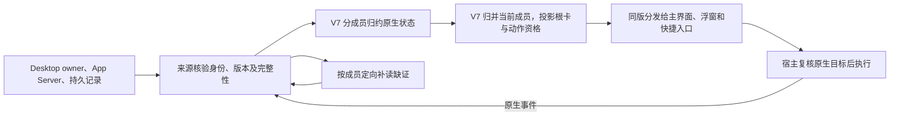

# Codex 原生状态一致性复核与改造方案

2026 年 11 月 19 日。沿用 `SPEC-261114-CODEX-STATE-SYNC`。结合官方资料、工作树调用链与现场证据，补充 R9–R15 和三批改造方案。[原始验收 S01–S10](raw-requirement.md#L41) · [整体设计](v7-state-redesign-plan.md) · [分批进度](delivery.md#current)

## 1. 对照原生的口径

同一账号、宿主、对话成员及轮次下，EyPc 应展现已经证实的原生运行、待答、审批、结束结果、Goal 及读态。主对话自身状态和整组还有什么待处理需要同时可见。例如主轮完成、Side 等审批时，根卡可归「待输入」，卡内写清「主对话已完成 · Side 待审批」。两项事实用同一 V7 快照交付，根卡、角标和快捷入口从该快照取值。未知或不可观测的原生状态使用可说明来源的核验状态。

| 序号 | 官方依据 | 对 EyPc 的约束 |
| --- | --- | --- |
| 1 | App Server 区分 Thread `notLoaded / idle / systemError / active`，`activeFlags` 表示等待审批或用户输入。Turn 另有 `inProgress / completed / interrupted / failed`。`turn/completed` 携带最终结果。 | 未加载、空闲及系统错误各有含义。完成需要该轮的成功证据。等待可以与运行并存。持久历史为空或未加载时，继续保留可独立证实的运行或等待。 [App Server 文档](https://learn.chatgpt.com/docs/app-server#track-thread-status-changes) · [0.170.0 的 Thread 与 Turn 结构](https://github.com/openai/codex/blob/rust-v0.170.0/codex-rs/app-server-protocol/schema/json/v2/ThreadReadResponse.json#L2667) |
| 2 | 原生请求有 `threadId` 和请求实例。`serverRequest/resolved` 可以确认答复，也可以确认原生清理。`turn/plan/updated` 是进度计划，原生 Plan 产物和用户交互另有来源。 | 分开处理原生请求、Plan 产物、Plan 实施。关闭以对应实例及来源的生命周期为准。11 月 6 日用户确定的「最新未实施 Plan 显示待输入」继续作为 EyPc 展示规则。 [审批与请求](https://learn.chatgpt.com/docs/app-server#approvals) · [Turn 事件](https://learn.chatgpt.com/docs/app-server#turn-events) · [当前 Plan 规则](../../PRODUCT_REQUIREMENTS.md#L419) |
| 3 | Goal 与 Thread 绑定，状态有 `active / paused / blocked / usageLimited / budgetLimited / complete`。连续执行依赖线程空闲、没有排队输入等条件。2026 年 11 月 10 日的 App 更新记录说明，退出或崩溃后重开可自动恢复符合条件的本地对话。 | Goal 可跨轮，展示应保留暂停、阻塞与限制原因。恢复使用原生匹配的最新执行事实，继续操作仍服从目标预检。 [Goal 结构](https://github.com/openai/codex/blob/rust-v0.170.0/codex-rs/app-server-protocol/schema/json/v2/ThreadGoalGetResponse.json#L50) · [官方 Goal 指南](https://developers.openai.com/cookbook/examples/codex/using_goals_in_codex) · [Codex app 26.1106 更新](https://learn.chatgpt.com/docs/changelog?date=2026-11-10) |
| 4 | `forkedFromId` 可描述复制历史的独立 fork。子 Agent 有独立生命周期，协作结果的状态与 Tool Call 自身也分别记录。 | 父子关系、独立 fork、人工 Side、机器子 Agent 及内部审查按各自可信来源准入。机器 `shutdown`、`notFound` 等只影响匹配成员及本次委派。普通 fork 是否在原生界面作为 Side 挂载须有会话或拓扑证据。 [App Server 的 `thread/fork`](https://learn.chatgpt.com/docs/app-server) · [官方子 Agent 指南](https://learn.chatgpt.com/docs/agent-configuration/subagents#managing-subagents) · [协作成员状态](https://github.com/openai/codex/blob/rust-v0.170.0/codex-rs/app-server-protocol/schema/json/v2/ThreadReadResponse.json#L433) |

公开协议定义事件和字段。本机原生对话的侧栏、编辑框、Side 面板、已读与重开体验，以实际部署版本逐项对照。Desktop v13 私有状态流按实测结构、连接代次和版本水位适配。11 月 19 日复核时安装的 App 为 `26.1111.71704`（29030），命令行为 `0.170.0`。11 月 20 日更新后的桌面、独立 App Server 和已加载 V7 分别登记。[前序现场](status-read-investigation-261116.md#v7-native-parity) · [更新后现场](status-read-investigation-261116.md#post-codex-update-261120)

## 2. 新发现与影响

### R9 · 已读改变了整组是否待继续

**P1，源码与旧版现场。** V7 先把「主完成、部分成员停止、全组终态」归为 `stopped`，再按是否有已完成未读成员把公开 `phase` 改成 `completed`。旧包同一五成员组从「已完成未读」变为「待继续」时，两次记录的成员相位相同。现有用例还明确写入这次变化。根完成而仅子任务停止时，根卡可进入「待继续」，其「继续任务」能力按原需求保持禁用。先决定哪些成员影响当前组并保留各自结果，再按读态生成未读样式与专用入口。清读只改变对应的读态及入口，已完成未读仍可达。[根任务聚合](../../../../preload/companion/task-kernel.cjs#L1769) · [既有用例的切换](../../../../tests/platform/companionTaskKernel.test.ts#L2526) · [五成员样本](status-read-investigation-261116.md#v7-native-parity)

### R10 · 待继续丢失原因，Goal 和 Turn 仍共用一组候选

**P1，源码。** 适配层把暂停、阻塞、使用量限制和预算限制的 Goal 译成 `turn-interrupted`，也把 Goal 完成译成 `turn-completed`。V7 把真实失败和中断都映成 `stopped`，只有精确的 `turn-interrupted` 有根中断保护，Goal 导致的停止或真实失败仍可能被同组的已完成未读遮住。在缺少新轮活动序号的冷恢复路径，旧 `Goal complete` 也可凭来源权重盖过一个后来发生的明确 Turn 失败或中断。另有同类问题，`active + waiting` 会生成一个完成候选，再由独立交互重建待处理状态。这些不同的事实最终只显示「待继续」或「等待」，根因和能否继续都难以对照。保留成员的真实 Turn 结果、Goal 状态和等待事实，在 V7 决定展示与动作资格。暂停或阻塞的 Goal 只恢复原 Goal。使用量或预算受限时展示原因，继续沿用户原有预算限制。真正的 Turn 失败、主动中断和连接故障分别可辨。 [适配器的 Goal、等待与 Turn 映射](../../../../preload/companion/evidence-adapter-v7.cjs#L90) · [候选优先级](../../../../preload/companion/task-kernel.cjs#L387) · [根中断保护](../../../../preload/companion/task-kernel.cjs#L503) · [继续执行预检](../../../../preload/codex/continue-task.cjs#L85)

### R11 · 原生整组仍活动的保护缺生产输入

**P1，源码接线缺口。** RAW-218 要求覆盖原生 Codex++／Cloud 空 Turn 页面和主轮结束但整组仍活动的情形。已有用例只验证空页后库存行得到 `inProgress`。生产私有分支和库存回退出口都没有设置适配器要求的 `groupActivityConfirmed`。根最新 Turn 已结束、子成员又暂时不可见时，这个条件无法保住经证实的整组活动，仍可能提前完成。优先用已准入成员供证，确有可信原生组活动且成员暂缺时传递同来源、同组、同代次的活动事实。更换宿主、明确组退出或当前成员证实结束时解除。旧缓存、历史的空 Turn 和打开时的短暂 hydration 只按相应的证据级别处理。[RAW-218 及额外 Host 边界](../../PRODUCT_REQUIREMENTS.md#L322) · [适配器条件](../../../../preload/companion/evidence-adapter-v7.cjs#L77) · [私有分支出口](../../../../preload/index.js#L9294) · [库存回退出口](../../../../preload/index.js#L12333) · [库存层用例](../../../../tests/platform/codexAppServerBridge.test.ts#L11158)

### R12 · 原生失败通知漏接，普通 Side 终态恢复不全

**P1，源码覆盖缺口。** 根任务的 `turn/completed` 快速路径只收成功和中断。失败进入补读，但该分支要求查询结果为 `completed`。普通 Side 的 canonical 快速确认也限于成功。另有独立的库存和快照补读能承认 `failed`，因此存在迟到才恢复、保留弱终态或继续未知的路径。归一三种真实终态，先带成员与 Turn 身份送入 V7。来源缺失时复用 R6/R7 的有界补读。匹配当前 owner 的直接事件、同轮持久记录和独立进程重建的弱证据各自保留来源强度。普通 Side 的确定中断、真实失败和跨进程重建仍须分别验证。[通知快速路径](../../../../preload/index.js#L4770) · [收到通知后转补读](../../../../preload/index.js#L8576) · [补读约束](../../../../preload/index.js#L6184) · [普通 Side 与无 owner 回退](../../../../preload/codex/desktop-activity-resolution.cjs#L386)

### R13 · 根卡缺导致等待、运行或停止的成员信息

**P1，当前产品可见性缺口。** Kernel 已持有成员图，公开包主要给根任务相位和成员数等统计。Codex 构造节点时清空非根成员的 Plan 产物。普通待输入走根卡的打开目标。因此只有 Side 在等待、Side 有独立 Plan、主问和子审批同时存在时，用户难以看到与原生对应的状态。V7 输出有界的成员摘要，优先说明影响根卡的成员及其状态。只有存在可靠目标时提供独立的「查看待处理分支」，根卡点击仍按原根目标。根完成而仅子中断时，显示在子成员上，继续操作只指向用户选定且具备资格的原生根任务。子分支的 Plan 可先保留只读事实，根 Plan 权限沿用原合同。 [非根 Plan 清理](../../../../preload/index.js#L12477) · [根投影统计](../../../../preload/companion/task-kernel.cjs#L1846) · [当前待输入打开入口](../../../../preload/companion/task-kernel.cjs#L3128) · [原执行边界](../../requirements/task-recovery-actions-raw-001.md#L15)

### R14 · 已准入的未知或有错对话缺明确展示

**P1，源码及旧版样本。** 来源识别 `systemError`，V7 缺少独立的会话错误展示理由。未置顶 `unknown` 会归 `none`，浮窗仍从 `stopped` 组拆取未知行。旧版日志观察到主轮已完成而整组转为 `unknown/none`。保留已准入对话的可检索身份，在已有详情或状态未知展示里标注原生错误、未加载或核验中。主轮已有可靠终态时可原样说明，整组同时注明哪些成员状态待确认。开放能可靠定位的打开入口，限制依赖当前状态的写动作。手动指定只作为用户本地标记，在匹配原生新证据后失效。[状态识别](../../../../preload/index.js#L10438) · [未知分组](../../../../preload/companion/task-kernel.cjs#L720) · [V7 消费组](../../../../src/domain/companionTaskPackage.ts#L609) · [浮窗读组](../../../../src/FloatApp.vue#L557) · [现场样本](status-read-investigation-261116.md#v7-native-parity)

### R15 · 并发成员争用父记录里的活动标记

**P1，源码。** App Server 在父库存记录的 `appServerLiveBranchThreadId` 只保留一个成员，`activeFlags`、`waitingSince` 随最后活动的成员写入。先收到 Side A 的活动或审批，随后收到 Side B 的运行，第一条分支在没有 Desktop owner 或新库存时只剩回退证据。B 随后结束时，整组可能漏掉仍运行或仍需审批的 A。库存的根表还同时承担注册和缓存职责，继续叠加标记会扩大冲突。复用现有成员证据结构，按 A、B 各自的来源、Turn 和活动区间登记 App Server 观察。父行负责成员登记，组结果由 V7 归约。在相同分支收到可信终态、补齐完整来源、换代或明确撤销关系时，仅解除该分支的旧标记。[成员活动写入](../../../../preload/index.js#L3524) · [Side 活动覆盖父字段](../../../../preload/index.js#L8438) · [分支投影只给一个 App Server 成员](../../../../preload/index.js#L9109)

## 3. V7 集中处理的顺序

1. **身份和完整性。** 沿用 V7 成员键、来源代次和完整集合水位。保留真实的 Turn、请求实例、Goal、Plan、读态及关系事实。来源端负责协议和因果信息取证。可比较但相冲突的事实同时交给 V7。空列表须携带覆盖范围，缺字段只影响对应状态项。
2. **成员状态。** 当前审批、待答和 Plan 请求优先表现为该成员待处理，运行仍保留在底层。Goal 约束它所属范围内的执行。明确旧 Goal 完成后开始的新轮，按新轮的真实结果展示。最新未实施的有效 Plan 依既定规则展示「待输入」。中断、失败、Goal 暂停或受限均保存一个可显示的有限原因，当前原生能力决定是否可继续。原生加载状态与证据新鲜度用于解释等待核验。
3. **整组状态。** 主对话待处理时保留其现有优先级。其余情况由当前成员的实际待处理和活动决定整组状态，并保留主对话自身的完成、中断或失败。关系、成员和同域时间都证明普通 Side 的中断发生在最新主轮开始之前时，旧中断退为历史。机器活动按匹配的委派关闭事实退役，机器成员沿用原生读态资格。时间不可比较时保留已有事实，并注明哪个成员待核验。读与未读只改读态及基于它的展示入口。
4. **公开展示与动作。** 根相位、导致该相位的成员摘要、原生原因和动作资格随同一个 `packageRevision` 发出。维持一个根卡，优先把状态原因放在已有行详情或可访问提示。公开包只需有限枚举、已准入成员摘要和必要的匿名导航目标。继续和实施的命令前置仍复核当前来源、原目标、轮次、Plan 或 Goal，失败或结果不明按原规则处理。回执仅结算发起操作。

| 序号 | 原生或 EyPc 已确认事实 | 同版展示与动作 |
| --- | --- | --- |
| 1 | 当前轮运行、已验证的原生整组活动、当前 Goal 持续运行 | 显示进行中并说明活动来自主对话、Side 或 Goal。只有组级证据时注明成员待确认。禁止归档仍活动的组。 |
| 2 | 当前输入、授权审批、Plan 选择或实施请求 | 进入待输入组并分辨「待答」「待审批」「待实施」。记录到具体成员和请求。匹配请求关闭后按该成员的真实运行或终态重新投影。 |
| 3 | 当前轮已完成并有最新有效的未实施 Plan | 沿 11 月 6 日决定进入待输入，注明「Plan 待实施」。原生请求、读态、插件本地暂停和实施能力各自可辨。 |
| 4 | 当前轮明确成功，并且当前组没有更高优先的待处理与活动 | 展示完成。由当前读态供出已读、未读或待确认。仍有子成员缺证时，应显示主轮已完成并说明整组待核验。 |
| 5 | 当前根轮中断或失败 | 可保留待继续组并标注「已中断」或「失败」。继续能力取决于准确根目标、当前状态与原生前置条件。只有 Side 中断时展示子成员原因。 |
| 6 | 当前 Goal 暂停、阻塞、用量限制或预算限制 | 待继续组内区分四种原因。暂停和阻塞按该 Goal 的原生恢复能力执行。用量或预算限制给出原因并保持限制。Goal 已完成或清除后的新轮由该轮结果供证。 |
| 7 | Thread 空闲、未加载、系统错误或缺少可信证据 | 空闲结合最新轮与交互判断。未加载和系统错误保留原生可解释状态。未知显示待核验和可定位的打开入口。只有实际原生终态建立完成、失败或中断。 |
| 8 | 人工 Side、机器子 Agent、独立 fork 或内部审查 | 当前 Side 和机器子 Agent 在关联根卡内体现成员状态。`pendingInit` 对应启动中，`running` 对应执行中，`interrupted / completed / errored` 各自保留结果。`shutdown` 只结束当前委派，`notFound` 需要确认关系或成员是否仍可读。独立 fork 独立展示，内部审查沿既定排除合同。 |
| 9 | 原生已排队输入、恢复中，或等待发送确认 | 在相应成员的已有详情显示可证实的等待原因，并保留正在运行的上一轮或已经明确的终态。只有新的原生启动才开启下一轮。未确认提交只影响该目标的询证和操作资格。 [Desktop 提交状态入口](../../../../preload/codex/desktop-shadow.cjs#L512) |

| 序号 | 标记 | 保留与解除条件 |
| --- | --- | --- |
| 1 | 旧运行保护、原生组活动 | 绑定连接、成员、轮次及权限来源。匹配的原生终态加可信空闲、明确组退出或更新轮次结束保护。原生在重开后自动续跑时，以真实新启动解除停态画面。 |
| 2 | 请求关闭、Goal 清除、Plan 已消费 | 绑定精确实例、同源完整集合或可比较版本。较旧或重复事件仍受限。允许经核验的同线程新实例以及已获准的新代次接管。 |
| 3 | 缺证和重试预算 | 暂存直到接纳、被同道完整基线覆盖或成员退役。询证按对象合并，同一需求结束后释放预算。超时只影响补读及对应操作资格。 |
| 4 | 归档和存储、身份故障 | 仍以准确根目标、活动成员状态、确认及存储可用性为准。对可识别的受损集合局部保护，成功回读并核对代次及数据版本后解除。跨版本或身份冲突继续要求重新接入。 |

## 4. 可以精简的实现

| 序号 | 可合并或退役的路径 | 实施条件 |
| --- | --- | --- |
| 1 | 将 Goal、等待和 Turn 的优先级放在 V7 一次裁决，删除适配器里的替代 Turn。把库存和补读对同一轮次的先后比较对齐到已有的 `branch-causality`。 | 来源继续判断协议可信度、过滤内部审查，识别独立进程重建及其他弱证据。执行器继续准确核验原生目标。两个来源以同一成员和轮次入核后产生一个业务结果。 [库存比对](../../../../preload/codex/inventory-turn-fields.cjs#L37) · [既有因果比较](../../../../preload/companion/branch-causality.cjs#L32) |
| 2 | 让根投影直接产出分组依据和动作目标，去掉浮窗从「待继续」二次捞「未知」的兼容判断。将公开包的语义判重、编号、通知消费方等共用尾段收成一处。 | 先查兼容调用者和真实缺包降级的覆盖。保留活动窗调度、局部偏好提交、R6 单次发布和 R5 渲染回执各自的语义。 [根组发布](../../../../preload/companion/task-kernel.cjs#L1957) · [本地发布](../../../../preload/companion/task-kernel.cjs#L2007) · [证据发布尾段](../../../../preload/companion/task-kernel.cjs#L2613) |
| 3 | 核对 `UNKNOWN_GRACE_MS` 的旧接口、固定资产检查和夹具。生产已由后续可信证据推进 unknown，旧常量在当前内核仅定义并导出。 | 退役旧接口时同步合同检查和仍引用它的用例。保留该用例验证的迟到终态与未知保持。 [常量](../../../../preload/companion/task-kernel.cjs#L50) · [资产检查](../../../../scripts/validate-utools-runtime.mjs#L234) · [用例](../../../../tests/platform/companionTaskKernel.test.ts#L3388) |
| 4 | 对一次实时事件冻结一份成员证据，来源去重和 V7 入核复用这份输入。现在计算活动指纹和构造 V7 批次都会重读私有分支。 | 保留来源去重、暂存接纳和公开语义去重的各自水位，用同一份输入避免指纹与实际消费取样不一致。核对一次事件的分支读取次数及接纳前后结果重放。 [来源指纹取样](../../../../preload/index.js#L8151) · [V7 再取分支证据](../../../../preload/index.js#L12375) · [实时入口](../../../../preload/index.js#L14065) |

## 5. 按真实事件顺序验收

对照同一账号、同一原生对话／Side、同一轮次或请求，先记录原生侧栏、对话和 Side 面板的状态，再串主界面、根卡、角标、快捷目标和实际浮窗渲染。只对能匹配的记录计算原生事件至接收、接收至 V7 接纳、接纳至界面应用三个时段。真实写操作由用户在受控样本执行。缺某类原生样本时，将该场景保留待验。

| 序号 | 场景顺序 | 验收结果 | 原需求 |
| --- | --- | --- | --- |
| 1 | 冷启动／重连 → 只读到 `notLoaded` 或 `systemError` → 当前 owner、下次清单或真实上线 | 对话与故障原因可找到，打开是否可用有依据。恢复后采纳同一来源的新证据。另核空历史但可信 `active`、不相干账号与 Cloud/Codex++。 | S01、S03、S07、S10 |
| 2 | 主对话完成 → Side A 挂起审批 → Side B 启动并完成 → A 恢复 → 全组完成 | A 的审批在 B 活动和结束时仍可见，两个无 owner 的并发成员也各有状态。另核主待输入与子待审批并存、Q1 换 Q2、旧轮异步问题仍开放。快捷入口、卡片和角标使用同版结果。 | S02、S04、S05、S09 |
| 3 | 主对话先完成 → 普通 Side 中断或失败。分别将 Side 放在主轮之前、期间及之后 | 较早已证实结束的 Side 仅保留历史。当前 Side 的中断或失败仍可见，根不自动可继续。缺关系、同秒不可比较及父终态后换父时保持精确限定。机器委派结束和独立 fork 分别对照。 | S02–S04、S07 |
| 4 | 主中断或失败 + 子完成未读 → 原生清读 → 主稍后重新开轮 | 读态变化不改变主中断或失败。清读之后根、成员和继续资格保持同一事实；看到真实新轮后撤销旧停态。再核主完成 + 子停止的相同读态变化。 | S02、S04、S06、S08 |
| 5 | Goal 跨轮 → 暂停／阻塞／预算或用量受限 → 恢复、完成或清除 → 新手动轮中断 | 每个原因可辨。真实 Goal 恢复与手动 Turn 继续采用各自预检。旧 Goal 终态与同秒迟到快照不能改写后续轮次。 | S02、S05、S08 |
| 6 | 最新 Plan 产出 → 有或无实施请求 → 关闭请求 → 用户实施 → 新 Plan 或新中断 → 旧回执迟到 | 最新未实施 Plan 按原决定显示待输入。匹配的实施消费原版本。普通补充、后续 Plan、暂停收据恢复和真实中断分别呈现。 | S05、S08、S09 |
| 7 | Owner 查询超时 → 漏实时终态 → 定向读回 → 浮窗收到新版和迟到旧包 | 无 owner 的普通 Side 成功、失败、中断分别有可追踪依据。同一轮的竞争先核当前来源。新版只在实际渲染后确认。 | S03、S04、S07、S09、S10 |
| 8 | 新版加载 → 切混合来源或关闭 Codex → 打开、置顶、归档、项目和新建分别走原入口 | 对齐 Host、Renderer 和包版本。显示与快捷同版。共享来源、额度、隐藏／暂停、排序及云端或 Windows 的目标路径按已有条件回归。 | S08–S10 |
| 9 | 主轮和已开始的成员均完成 → 人工 Side 的 Turn 查询失败或只有关系 → 成功读回完整空页 → Side 发出首个 Turn | 前段保持待核验。空页经 V7 接纳后，根卡按已完成成员归组，Side 保留关系并显示「尚未开始」。真正开轮后按当前运行归组。原生未读及根继续资格分别对照。 | S02、S04、S06–S09 · [R22 进度](delivery.md#r22) |

### 两组受控续验与 R21

1. **交叉审批。** 在已完成主轮的测试对话内使用两个人工 Side。A 出现原生审批后先保留，运行 B 直到结束，再由用户解除 A 的请求。逐步核对 A 的请求仍在原成员下，根卡在 A 挂起时保持待审批，B 的开始与结束只更新 B。A 解除后按成员当前结果回落，原已完成的主轮保持完成，根继续资格关闭。
2. **主轮中断后清读 Side。** 先取得主轮原生中断、人工 Side 完成且有未读的并存状态，再由用户从 Codex 清读该 Side。清读前后对照根卡的「待继续」、该组是否属于完成未读入口、继续按钮是否可用。未读入口在清读后移除该样本的完成未读资格。根卡维持待继续，根动作资格仍按该轮和组内阻断判断。
3. **R21。** 先记录当前原生 Turn 和运行状态，再只重载 EyPc。用重启前后的同一 Turn、原生状态、新握手和首包判断是否持续运行。首包应显示已核实的进行中。Desktop 实时连接不可用时另核同轮运行文件的补证与浮窗应用，证据不足时观察待核验与后续恢复。以原生已中断且已空闲的主轮对照待继续及继续资格。[冷启动续修](delivery.md#r21-cold-ownerless-261122)
4. **R21 稳定性与耗时。** 同一轮在首个有效包之后也应持续按当前活动归组。观察后续原生未读基线、定向回查和库存就绪时有没有闪退。按握手、库存证据完成、V7 发布和双端应用分段计时。Main 配置页核共享包和计数的渲染，逐任务行在 Float 对照。[11:07 实机证据](status-read-investigation-261116.md#r21-reload-1107-261122)

本轮覆盖来源预处理、V7 候选及成员归约、拓扑、根视图和继续／实施入口。14:11 包有当前聊天的运行发布和历史混合组样本。17:26 构建仍待匹配宿主握手及原生画面对照。原 R1–R8 的实机验收继续开放，R9–R15 的实施与手测按后续批次记账。[分批进度](delivery.md#parity-batches) · [验证影响图](../../../knowledge/core-verification-map.json#L87) · [现场取样](status-read-investigation-261116.md#v7-native-parity)

## 6. 实施结果与剩余验收

B04–B06 已落地，前列 R9–R15 保留为改造前发现。清读不再改变根组相位，Side App Server 活动按目标成员隔离，Goal 和 Turn 可共同显示。V7 给出已完成未读入口、状态未知分组、子成员摘要及根能力。原生组活动有当前 connector 的生产输入。完整接纳与同版分发通过随包检查。[实现与限制](delivery.md#b04-b06-review) · [核验记录](status-read-investigation-261116.md#b04-b06-verification)

当前摘要优先展示待办和正在运行的子成员，最多八项。底层继续保留已准入成员的状态。挂起请求和未实施 Plan 能显示到成员。缺少可靠独立打开目标的 Side 从根对话进入。原生未证实的排队阶段、机器委派的细枚举与不可见成员，仍使用可观察的 Turn、待确认事实及既有退役证据。新版已核启动时延及完成组清读。审批并发和停态组清读待采样。 [同版现场验收](status-read-investigation-261116.md#parity-host-acceptance-261119)

兼容复核已补齐旧轮附带标记、待继续卡的未读快捷确认、Side 换父、旧进程尾帧和历史 Plan 的当前动作资格。11 月 20 日同标识宿主已核 R22 恢复及浮窗应用。R21 的原生同轮在重载前后运行，库存中断先到，首个可见包为进行中。合法待继续、双 Side 交叉审批和停态组清读继续验收。冷启动人工 Side 补证触发和机器成员发现范围另见 R23。 [R16–R20](delivery.md#parity-regression-review) · [同版现场](status-read-investigation-261116.md#v7-live-acceptance-261120) · [R23](delivery.md#r23)

## 7. Codex 更新后的改造方案

11 月 20 日的原生和 EyPc 对照确认了三类差异。桌面进程在运行，旧 IPC 已失联。独立 App Server 的历史可读，部分精确 Side 的补读仍被桌面连接和主轮状态卡住。根组曾把已确认的主轮中断遮成未知，也把已完成的新主轮随旧机器中断带入待继续。[实机时间线](status-read-investigation-261116.md#post-codex-update-261120) · [R24](delivery.md#r24) · [R25](delivery.md#r25) · [R26](delivery.md#r26)

### B07 · 明确能提供实时事实的来源

1. **探查桌面实际入口。** 在相同本机宿主和账号下，用正在运行的同一目标核对 `thread/read` 状态以及相邻原生事件。按运行、请求开闭、完成、关系和读态分别确认通路能力。有原生消息能力的入口先验证来源身份、会话、协议及接收覆盖，再接现有 Host 适配。公开 App Server 定义传输协议和已加载线程的运行语义。本次检索的公开更新记录未给出该桌面版本的私有 IPC 接替入口。[官方协议](https://learn.chatgpt.com/docs/app-server#protocol) · [线程状态](https://learn.chatgpt.com/docs/app-server#track-thread-status-changes) · [官方更新记录](https://learn.chatgpt.com/docs/changelog)
2. **正常处理降级。** 将桌面进程是否存在、IPC 是否已连、来源能提供的证据分别记录。旧端点 `ECONNREFUSED` 进入「实时通路不可达」。退出已建立连接时清退该代流、owner 权限及在途响应。后续重连失败沿用现有退避，只更新连接诊断。新代通过身份、协议和能力验证，并取得对应通道基线后恢复实时取证。管理型 App Server 在本机可读历史，对两个运行根都返回 `notLoaded` 和弱中断，当前只具备已核的历史用途。实时入口尚待确认时，B08 可用已验证的历史通路推进。[现有断线处理](../../../../preload/index.js#L7852) · [重连调度](../../../../preload/index.js#L6363) · [状态来源模式](../../../../preload/index.js#L4126)

### B08 · 按成员补证，区分查询失效与已接纳历史

1. 对已经准入、父子关系精确的人工 Side，按成员自身的轮次、请求或 Goal 缺口安排有界历史补读。覆盖主轮已完成、运行及停态三个入口。在线的 owner 查询与历史补读共用现有目标队列、在途合并及优先级。历史查询不以 Desktop 连接为前置。以当前绑定、目标成员、关系版本和缺证通道合并同一需求。复用最新 Turn、精确中断、完整空页与 Goal 的取证检查。机器成员发现仍在已准入根内验证精确关系，内部审查沿用原过滤规则。[现有定向补读](../../../../preload/index.js#L5751) · [owner 触发](../../../../preload/codex/desktop-request-projection.cjs#L149) · [空页验证](../../../../preload/index.js#L10505)
2. 在途结果必须回到发起时的来源、账号、关系和证据版本。改用现有可用来源时重新取证。已接纳的历史只证明特定轮的结果，或在某次完整核验时为空。与当前账号、成员关系及持久记录仍相符时，按需重新验证后复用。由断开连接确认失效的是实时权限及其覆盖。新 Turn、请求、提交、Goal、持久记录变化、换父、移除和账号切换分别影响对应缓存。历史补读超时、空结果有游标及完整度不足时保留原因，等当前证据补齐。[当前缓存作用域](../../../../preload/index.js#L10485) · [活动取证与缓存](../../../../preload/index.js#L9369)

### B09 · V7 统一裁决主轮、整组、读态和动作

1. Host 对身份、协议、来源代次和证据完整度做前处理，按成员和轮次送入 V7。V7 一次给出已确认的主轮结果、整组当前工作、具体成员的缺证原因、未读和动作资格。同一个 `packageRevision` 给到主界面、浮窗和快捷入口。保留当前原生审批、待答及运行信息，主轮已中断时仍能说明中断及哪条 Side 待核验。组内活动和继续资格分别依当前证据确定。主终态已确认但仍缺活跃覆盖时，继续入口显示对应阻断原因。[V7 根归约入口](../../../../preload/companion/task-kernel.cjs#L1830) · [同版视图](../../../../preload/companion/task-kernel.cjs#L878)
2. 复查已证实无 Turn 的人工 Side。现有过滤仅作用于主轮完成时。精确关系、完整空历史且当前无请求、提交、Plan、Goal 或读态冲突时，可由 V7 在不同主相位下统一识别「尚未开始」，保留成员并退出相位归约。真正开轮或出现相冲突的事实后重新参与。关系占位和未证实的空页继续待核验。读态由实际有资格的完成成员及原生读回执供证。[成员无 Turn 语义](../../../../preload/companion/task-kernel.cjs#L1312) · [当前过滤](../../../../preload/companion/task-kernel.cjs#L1837)
3. 保留 R21 的弱中断过滤。将现有仅因组状态文字而起效的继续判断收回 V7 的明确动作资格，按准确原生根、当前 Turn 和组内活动范围裁决。命令执行器沿用写前目标、当前 Turn、活动请求、Plan 和 Goal 复核。命令回执只结算对应操作。组件读取包中的状态及能力，精简等价的 Host 补读过滤和界面分组判断前，先逐一核对调用者与旧入口。[弱中断过滤](../../../../preload/companion/task-kernel.cjs#L389) · [当前继续门禁](../../../../preload/companion/task-kernel.cjs#L1877) · [写前检查](../../../../preload/codex/continue-task.cjs#L37)
4. 将机器 spawn 关系、运行结束和当前待办分别入核。精确的旧轮终止且早于当前已完成主轮、当前运行及待办覆盖已确认时，评估只在成员历史保留该旧中断结果。当前 `open` 的关系可继续展示。保留现有显式关闭保护。新运行、挂起请求、不可比较的时间和不完整的活动覆盖都有明确状态依据，避免只凭旧终态或关系将机器成员静态归为已结束。[当前机器证据入口](../../../../preload/index.js#L9043) · [当前归组条件](../../../../preload/companion/task-kernel.cjs#L1837) · [R26](delivery.md#r26)

| 序号 | 阻断对象 | 解除及旧证据失效条件 |
| --- | --- | --- |
| 1 | 实时权限、旧运行保护 | 来源换代即拒绝旧代帧和响应。用同实例、同成员的当前基线恢复实时权限。真实新轮、同轮确证终态和匹配的可信空闲推进对应状态。弱历史中断保持待核验。 |
| 2 | 成员关系、空历史和补读 | 当前关系与完整历史补齐该成员的事实。首轮、当前待办或 Goal、提交及持久记录变化使旧空历史退出。换父、移除、账号变化使旧作用域失效。超时和耗尽只影响本次取证。 |
| 3 | 审批、待答、Plan 和 Goal | 保持到匹配成员及请求实例关闭、该通道完整快照证实失效，或同范围的新版本接管。其他成员完成、读态变化或单次断线不代表请求关闭。过期等待可显示待核验，当前缺证继续保护受影响写操作。 |
| 4 | 继续和实施 | 准确根、当前轮、待办覆盖及原生可写资格全部确认后开放。新活动、交互、Goal 限制、Plan 版本变化或目标丢失使旧资格退出。只有匹配完成成员的清读更新完成未读入口。 |

### 真实顺序与验收端点

| 序号 | 场景 | 通过条件 |
| --- | --- | --- |
| 1 | 更新前记录当前轮及两条历史 Side → 更新换代 → 退化 → 原生实时接回 | R21 的持续运行首包保持进行中。旧代不得关闭新请求或覆盖新轮。R22 的完整空 Side 可由同账号历史补证，R23 的已完成 Side 在根运行时也收敛。对照用户 Side、机器成员和组的读态。 |
| 2 | 同一根确实中断且原生已空闲 → 一条 Side 刚完成未读 → 从 Codex 清读 → 再开主轮 | 记录真实停态、未读入口和根继续资格。清读只移除该完成轮对应的未读资格。新主轮使旧继续目标失效。加验只有关系或已证实无 Turn 的 Side，主轮结果始终可见，当前证据决定动作是否开放。 |
| 3 | 主完成 → Side A 审批挂起 → Side B 开轮并挂起另一审批 → B 解除并完成 → A 解除 | 两条请求按自己的成员和实例显示、关闭。B 完成后 A 仍待审批。主轮仍完成。逐步核根卡、Side 摘要、待输入入口和继续资格。 |
| 4 | 同轮成功完成和原生未读 → 同轮清读或新轮 → 迟到的旧读态及旧窗回执 | 依据确切成员和 Turn 更新未读。主界面、浮窗和快捷入口使用同包。同窗回执分别记录收到与应用，旧回执不能结算当前包。 |
| 5 | 重连或历史补读中发生换父、账号换绑、Goal 清除再新建、新轮及真正失败 | 以各自的当前证据更新目标，旧代或旧实例退出。原暂停收据、归档保护、共享来源和准确导航仍按现行范围回归。 |
| 6 | 机器旧轮确认中断 → 主轮重新开始并成功完成 → 某机器成员真实重开或出现请求 | 比对 `open`／`closed` 的委派关系和原生机器状态。确认仅剩历史时保留成员结果，根随新主轮完成，根继续资格关闭。当前真实待办或活动到达后重新参与归组。另核同轮读态与完成未读入口。 |

先复用 11 月 20 日运行及完成未读的时延作为对照。每个新样本记录原生事件、Host 首次取证、V7 发布和同窗应用。对补读另记缺证到发起及发起到回读。对 R21 区分仅弱中断的启动窗口和真正中断后持续空闲的场景。两个受控写场景、卡面及继续按钮仍待实机对照。[分批台账](delivery.md#post-update-batches) · [现有应用回执](status-read-investigation-261116.md#post-codex-update-261120)

## 8. 重开基线与置顶、待输入的续修

11 月 20 日 14:33 重开后，原包完成新宿主握手。当前运行聊天恢复置顶。原生空闲且有可实施 Plan 的样本出现「待输入」，其请求数为零。随后旧 IPC 仍拒绝连接，库存仍有 `protocol-error`。此次以同版握手、同一成员和轮次、同窗应用为基线，分别核对冷读与后续增量。[实机记录](status-read-investigation-261116.md#reopen-parity-261120)

| 序号 | 批次 | 实施方案 | 旧证据失效及验收 |
| --- | --- | --- | --- |
| 1 | B07 | 已建立的 Desktop 连接退出才清退实时权限。失败重试沿原退避。桌面进程检查负责确认进程是否退出，连接错误保留自己的诊断。 | 旧代响应退出，保留 owner 和目标身份检查。验证重复拒绝连接期间，持久库存可以完成。已连接后实际断开仍清退旧实时帧。 |
| 2 | B08 | 复用库存读取补查已登记的 Side 目标。按原生关系和宿主身份接纳，空历史需完整页和一致的持久记录。置顶变化直接进入现有 Codex 刷新队列，跳过归档与活动清单预读及短缓存。原生分区给置顶事实和手动顺序，旧版继续兼容镜像。 | 置顶、取消、移分区、重排后等原生回读。空历史因换父、新轮、请求、Goal 或记录变化失效。验收确认置顶更新只改变图钉和适用的排序。 |
| 3 | B09 | 将 rollout 的当前 Plan 就绪送到既有产物证据。V7 归组时同时使用精确请求和 Turn 结果。已确认主轮停态即使组内缺证仍可见，未核成员继续阻断依赖组状态的写入。 | 复验 Plan 生成、补充消息、实施、迟到清除及当前真实审批。两条 Side 的请求分别关闭。主中断后清读只更新未读，后来的新主轮取代旧继续目标。 |

实施影响集中在 Codex Host 的连接、库存、Pin 和 Plan 事实，及 V7 的 Codex 根归约。沿用现有公开包和浮窗应用合同。验证通过 EyPc 前置 closeout、原生只读对照、构建后同版握手及 [顺序验收表](#post-update-acceptance)。独立 App Server 的未加载历史继续受 R21 约束。旧 IPC 接替、真正挂起的两条 Side 和 R26 的当前机器活动覆盖均需现场证据。当前聊天直接实施。

1. 连接降级时，`not-running` 需要既有进程探针明确返回不存在。旧代帧与写操作继续受原守卫约束。库存读因真实换代作废时记录作用域变化，供同版实机对照。[连接退出](../../../../preload/index.js#L7864) · [库存作用域](../../../../preload/index.js#L10794)
2. 已登记的 Desktop 人工 Side 从原生 `thread/read` 回填缺行，须匹配直接父关系及活动会话目录，再经现有库存审核。有会话身份冲突时保留缺证。来源会话、根或关系换绑退出在途读取。已接纳的完整空页随原生记录保留。[Side 补证](../../../../preload/index.js#L10504) · [关系审核](../../../../preload/codex/inventory-thread-topology.cjs#L71)
3. 置顶镜像与有 `threadId` 的分区通知均触发一次现有 Codex 刷新。原生 `section` 决定是否置顶，完整有序分区提供手动顺序。置顶分区使用 `useStateDbOnly`，最多五页。未取得完整一致结果时沿用镜像排序。CodexHost 和本地置顶沿各自事实入口。该版本分区通知的实际覆盖与 `updated_at` 原生排序偏好仍待对照。[刷新队列](../../../../preload/index.js#L8040) · [分区读取](../../../../preload/index.js#L10480) · [置顶映射](../../../../preload/codex/pin-bridge.cjs#L243)
4. Plan 经轮次和产物修订后进入统一生命周期，取消或实施的现行证据挡住旧 Plan 重放。V7 同时给主轮、整组、未读入口和动作资格。主轮确认中断但组覆盖不全时，展示停态与成员核验原因，继续和归档均受阻。确认从未开轮的 Side 保留在成员列表，并退出相位归约。R26 的 `open` 委派仍按当前已有证据参与，待取证后评判历史停态退出条件。[Plan 热更新](../../../../preload/index.js#L9900) · [V7 根归约](../../../../preload/companion/task-kernel.cjs#L1830)
