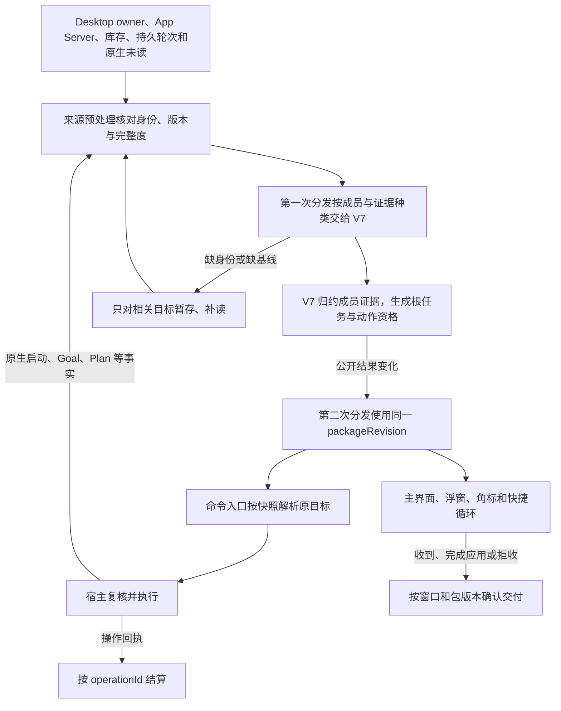

# Codex 任务状态统一改造方案

## 2026-11-25 Astra 评审实施约定

1. **首个完整包。** 同一来源作用域完成原生活动库存覆盖并成功投影后，Codex 才满足完整条件。暂存活动按成员和证据通道与该次基线对齐。未被基线覆盖的有效事实在同一提交中重放。首次覆盖失败保留待核验，已取得完整包后的暂时故障降级并保留上次已核成员。验收重载前已有运行轮次、采样中开闭请求、首包后下一次开轮。[完整首包约定](delivery.md#verified-first-package-build-261122)
2. **定向补读与后台库存。** 有原生 ID 的通知按目标合并查询并提交增量。无 ID 的 WAL 唤醒合并安排一次独立的有界库存对账，随后无通知也会执行。索引末页只证明索引遍历结束。确证缺少的范围和冲突交给原生全量读取。实测同一 App Server 的默认列表在途时定向查询，只有观察到服务侧互阻才升级为独立只读来源。
3. **拓扑和读态。** 局部结果只更新本次核实的成员和父边。整来源撤边须在同账号、宿主和代次的完整关系覆盖下提交。归档撤成员，换父撤指定的旧边并更新新边。失效查询不能复活旧关系。无当前完成实例或已核读态版本的清读通知只唤醒回读，旧轮清读不能覆盖后来的完成。
4. **继续资格。** 保留真实停态分组。确证中断或失败且其他阻断项已核清时，`thread/goal/get` 明确返回 `-32601` 可用旧协议继续。查询超时、被拒或回包畸形时保留核验并禁止发送。主轮已完成的暂停或受阻 Goal 必须核对当前 Goal 和完成实例，子成员仍未知时继续保持禁用。
5. **切换验收。** 从准入前的独立原生样本列出应入包的成员、Turn 和每次状态变化。新旧输出相同也要逐项检查共同漏收。缺失、错误和超时逐项结算，成功样本的 P95 不抵销漏收。Main 和 Float 分别用同宿主、同包及各自当前窗口的可见回执验收。冷启动分别对照 IPC 可用和断线，比较首个完整包的中位耗时及最慢样本。[统一脚本验收规则](../../../rules/project-runtime.md#companion-task-count-acceptance)

2026 年 11 月 19 日设计评审稿，关联 `SPEC-261114-CODEX-STATE-SYNC`。本文记录实施前 EyPc 的 Codex 状态链和共用 V7 内核的八条风险。[Codex 状态同步原需求](raw-requirement.md#L9)

前三个批次已完成本地改造。后续原生状态复核补充了「待继续」、主子并发和状态展示的风险。[分批进度](delivery.md#current) · [全链核验表](delivery.md#architecture-review) · [原生状态一致性复核](native-status-parity-plan.md)

## 1. 两次分发，一处判断任务状态

建议把**轮次状态、用户是否仍需处理、Goal 是否仍有效、根任务分组和操作资格**统一交给现有 V7 内核。第一次分发携带可比较的事实，第二次分发交付同版结果。协议验证、成员准入、定向补读、命令执行校验和界面交付回执各有自己的责任。[V7 状态权威](../../PRODUCT_REQUIREMENTS.md#L259) [V7 更新事务](../../../../preload/companion/task-kernel.cjs#L2484)

置顶分区作为元数据进入同一事实入口，Plan 就绪作为产物证据进入产物生命周期。Desktop 的实时权限与持久历史各用自身的作用域。V7 归约时可同时保存已确认的主轮结果和整组尚缺的证据，用同一结果约束动作和展示。[重开续修设计](native-status-parity-plan.md#reopen-parity-plan-261120)

| 序号 | 责任位置 | 输入和输出 |
| --- | --- | --- |
| 1 | Codex Bridge 与来源适配器 | 核对账号或来源域、连接代次、owner、线程与成员关系、同源版本连续性。解析轮次、请求、Goal、Plan 与原生读态。输出明确的新增、清除、完整集合、局部更新或未观察，保留互相冲突的可信证据供内核比较。[Desktop 帧与版本准入](../../../../preload/codex/desktop-protocol.cjs#L196) [精确成员准入](../../../../preload/index.js#L6861) |
| 2 | Host 第一次分发 | 复用实时 Activity Delta、冷预检和 V7 evidence batch。一个成员的一次输入只构造一份不可变证据。已准入目标直接投递，未准入目标有界暂存。分别记录“来源已见”和“内核已采纳”。[实时证据入核](../../../../preload/index.js#L14065) [首包预检](../../../../preload/index.js#L13221) [现行增量指纹推进](../../../../preload/index.js#L8309) |
| 3 | V7 内核 | 在同一事务中先更新成员的 Turn、交互实例、Goal、Plan、读态，再按当前成员关系归并根任务，导出分组、计数、循环和能力。相同语义沿用原包版本。[同轮、同域因果比较](../../../../preload/companion/branch-causality.cjs#L32) [V7 交互实例与关闭记录](../../../../preload/companion/task-kernel.cjs#L1152) [根任务归并](../../../../preload/companion/task-kernel.cjs#L1769) [V7 公开视图](../../../../preload/companion/task-kernel.cjs#L864) [同状态零发布](../../../../preload/companion/task-kernel.cjs#L1102) |
| 4 | 命令与消费方 | 命令按当前目标复核后执行。执行结果结算原操作，新的宿主事实回到第一条路径。主界面收到投影、浮窗收到包、Vue 完成应用是三个可区分的时刻。[现行继续回执结算](../../../../preload/companion/task-kernel.cjs#L3256) [主界面应用任务包](../../../../src/runtime/codexController.ts#L2540) [浮窗渲染后回执](../../../../src/FloatApp.vue#L777) |

## 2. 真实事件按发生顺序核验

时间均为上海时间。核对当前工作树基线 `81bf91b`、既有未提交改动、随包身份和 uTools 脱敏诊断。11 月 19 日 11:03:26 的握手对应 10:31:20 构建。实机核验窗口截止 14:54:00，对应这份已加载的构建。14:11:01 的新包已有构建身份，该设计取样结束后已于 14:57 获得宿主握手。[后续实机记录](status-read-investigation-261116.md#L266) 下列每一行单独关联任务或成员、宿主会话与包版本。[11:03 加载记录](status-read-investigation-261116.md#L246) [14:11 构建与重载记录](status-read-investigation-261116.md#L264)

| 序号 | 已观察的事件顺序 | 可以判定的事 |
| --- | --- | --- |
| 1 | **启动与准入。** 19:38 构建上，09:52:53.895 收到有效启动帧，53.907 记录暂存。09:53:10.552 准入，10.904 重放，10.945 发布运行包 #89，11.074 浮窗应用。 | 首帧到准入 **16.657 秒**，准入到应用 **522 毫秒**。R6 的暂存与重放有真实样本。这个样本发生在已有首包的会话，尚不能验证首包前短暂提问的去向。[19:42 加载记录](status-read-investigation-261116.md#L207) [启动准入现场](status-read-investigation-261116.md#L236) |
| 2 | **子分支 owner 超时。** 11:03:31.341 同一成员入队并发出，36.408 超时并开始持久补读。36.431 根任务在 #6 进入完成未读，36.436 记录子分支补读结果为中断，36.508 浮窗确认已应用后续包 #8。 | 补读结果的日志写在根任务发布之后。#6 有发布证据，#8 有实际应用证据。该序列证明超时后可恢复，R7 的“同签名再次需要查询却被拦住”还缺后一次调用的记录。[子分支补读与清读现场](status-read-investigation-261116.md#L247) |
| 3 | **XL 完成与浮窗应用。** 13:32:57.268 原生完成，13:33:01.845 Host 收到完成帧。01.985 发布“待继续” #155，02.158 收到该版应用回执。02.282 发布“已完成未读” #156，02.609 收到该版应用回执。 | 同一根、同一轮产生两个真实可见版本，相隔 **451 毫秒**。原生完成到最终应用 **5.341 秒**，其中 **4.577 秒**发生在首帧收到前。#155 当时是否该显示待继续，还缺触发该版的各成员证据。R5 的旧包拒收竞态另需验证。[XL 完成现场](status-read-investigation-261116.md#L255) |
| 4 | **已知中断对照。** 14:01:50.449 原生中断。14:02:13.594 至 17.980，同一主分支 14 次记录 `exact-branch-live`，旧运行起点比 owner 快照晚 338 毫秒。原任务于 14:12:07.626 开启真实新轮。 | 同轮中断被旧活动挡住有现场证据。首个拒绝前已过 **23.145 秒**，之后重复拒绝另计。新轮产生后，旧中断只能解释上一轮，不能再把当前任务拉回待继续。[同轮中断与旧活动冲突](status-read-investigation-261116.md#L261) [14:11 构建与重载记录](status-read-investigation-261116.md#L264) |

11:03 会话截至 14:54 的 94 条 Desktop 请求投影里，待答数和可见数均为零。318 条主／子终态仲裁诊断的 Goal 状态均为 `none`。这段日志有 352 条浮窗应用回执，但旧包拒收的兼容分支可以静默推进水位。给 R1、R2、R3、R4、R5、R8 定性时，缺的分别是实例替换、Goal 清除与旧值的先后、同操作迟到回执、两轮问题归属、收包后渲染前的迟到旧包、以及暂停存储故障。八条风险均已核对源码顺序，完整故障排列尚无同版本自然复现。[来源和发布阶段的诊断](../../../../preload/codex/runtime-diagnostics.cjs#L27) [旧包拒收时的处理](../../../../preload/codex/float-bridge.cjs#L1885) [已知暂停范围故障用例](../../../../tests/platform/codexAppServerBridge.test.ts#L1491)

## 3. 八条风险的责任、阻断与失效

按风险进入状态链的位置排列。各项先记设计评审时的实现及触发顺序，再给预期裁决和解除条件。源码链接定位到工作树中的现行入口。Q1、Q2 表示不同请求实例，T1、T2 表示不同轮次，N 表示任务包版本。

### R8　启动时暂停记录迁移失败

先读取 V7 暂停记录，遇到旧记录则迁移。未知版本、读取异常或迁移写入失败会令共享内核无法创建。评审时的用例要求迁移持久化失败时内核为空。B03 将已知范围和未知范围分别处理。[暂停收据版本与迁移](../../../../preload/companion/persisted-side-state.cjs#L71) [共享内核启动条件](../../../../preload/index.js#L13627) [已知暂停范围故障用例](../../../../tests/platform/codexAppServerBridge.test.ts#L1491)

**建议有条件缩小影响范围。** Host 继续验证整体运行身份、协议和存储格式。整体身份不兼容仍走 `reload-required`。若故障仅涉及暂停记录，且能证明某任务与暂停记录无关，允许 V7 发布该任务的可信状态。对涉及 Plan 或无法判定是否暂停的任务，保留原有可见性保护，暂缓会取消暂停、重新曝光或执行该 Plan 的动作及快捷候选。无法界定受影响集合时沿用现有全局阻断。区分已验证为空、不可读与不可持久化，保留旧收据供回退。成功读取兼容数据，或迁移写入并回读一致后，按原任务和 Plan 版本重新投影。该项涉及共享启动合同和其他来源，宜单独实施、验收。

### R6　首包前到达的变化

来源先收到变化，上游更新去重指纹，然后通知监听者。此时若公共首包尚未完成，实时入核入口直接返回。若同一提问在预检完成前打开又关闭，最终库存可以恢复“现已关闭”，却无法单独证明中间两次变化都被接纳。[现行增量指纹推进](../../../../preload/index.js#L8309) [现行首包接纳与重放](../../../../preload/index.js#L13143)

**保留成员准入，补齐接纳回执。** V7 反馈已采纳、已覆盖或待补读，Host 据此推进去重记录。按连接代次、成员、证据种类和源版本暂存必要增量。只有 V7 接纳、确认是重复事件，或同源完整基线已覆盖该版本，才消耗对应记录。身份核准后先对齐基线，再按可比顺序重放。若 Q1 已关闭，首个可见包应呈现当前事实，诊断仍能解释其打开和关闭。旧连接、确认归档或换父使原上下文失效。暂存溢出时标记该通道待补读，定向取得完整基线，未观察的历史边缘保留为未知。

### R7　一次 owner 查询失败挡住后续恢复

目标需要 owner 快照，查询发出时便写入 `attempted`。查询超时或发送失败后，如果目标与轮次签名相同，再次进入同模式可能直接返回。收到可信广播、换代、目标签名变化或普通 Side 持久补读可以另行恢复。owner 查询成功返回只表示可向该 owner 定向订阅。[现行同签名重试预算](../../../../preload/codex/desktop-request-projection.cjs#L332) [owner 超时与定向恢复](../../../../preload/codex/desktop-request-projection.cjs#L193) [定向订阅与查询回执](../../../../preload/codex/desktop-request-projection.cjs#L356)

**询证调度留在 Host。** 相同成员、轮次、连接和询证目的的在途请求继续合并。取得匹配轮次的可信快照、证据已被更强终态覆盖、成员移除或父关系变化时，关闭原需求。暂时失败只结束此次尝试。现有退避结束且目标仍缺证据时，允许新的有界只读询证，保留活动预留名额。达到预算就保留待核验，等待连接、轮次或来源变化再评估。14:11 源码中的广播宽限、后台排队截止、回应超时和后台退避分别是 250 毫秒、1 秒、5 秒和 30 秒，四者都不能改变业务相位。[owner 查询限额](../../../../preload/codex/desktop-request-projection.cjs#L32) [当前目标是否需要询证](../../../../preload/codex/desktop-request-projection.cjs#L105)

### R1　同一帧用新问题替换旧问题

同一成员、同一轮已有 Q1。下一帧移除 Q1、加入不同 ID 的 Q2，同时 runtime 从有等待的形态恢复为普通 active。Q2 先取得新观察序号，Bridge 随后按等待类型写入更高的清除序号，Q2 可能在入核前被隐藏。[请求实例身份](../../../../preload/codex/desktop-request-projection.cjs#L643) [按等待类型找旧标记](../../../../preload/codex/desktop-request-projection.cjs#L848) [恢复运行时写清除序号](../../../../preload/index.js#L5340) [等待可见性判定](../../../../preload/codex/waiting-evidence.cjs#L35)

**实例开闭收回 V7。** 适配器同批提交 Q1 的关闭与 Q2 的打开。内核只关闭 Q1，为已关闭的实例保留防重放记录，Q2 继续让该成员待输入。真实匹配答复、撤回，或可信的同成员同通道完整集合确认 Q2 消失时才解除。若来源只有粗粒度等待标记，恢复运行可以退役该标记，但无权清除仍有精确身份的请求。局部帧没带请求集合时沿用上次可信集合。[V7 交互实例与关闭记录](../../../../preload/companion/task-kernel.cjs#L1152)

### R4　普通 Side 旧轮遮住最新轮的未答问题

主任务已完成。Side 的历史 T1 仍标进行中且没有问题。最新 T2 已完成生成但留有未答问题，owner 空闲、原生请求为空且无活跃覆盖记录。当前问题提取优先选 T1，T2 只参与答复或继续指令的扫描，随后普通 Side 的成功终态可能获准，整组提前完成。[Side 选择问题所属轮次](../../../../preload/codex/desktop-shadow.cjs#L251) [普通 Side 终态准入](../../../../preload/codex/desktop-activity-resolution.cjs#L386)

**成员轮次与交互分别归约，再聚合根。** 来源同时提取 T2 的未答实例和 T1 有证据仍开放的实例，按成员、轮次、请求身份去重。V7 可同时记录“T2 生成完成”和“用户尚待回答”。匹配答复、明确撤回或已有协议认可的同实例取代事件才结束等待。其他成员完成、同轮重复启动、历史 T1 的运行标签均不解除 T2 的问题。根任务、角标、快捷入口须一起转入待输入，仍有活跃成员时归档继续受限。[异步问题历史现场与规则](../../../knowledge/error-memory/codex-canonical-async-question-lifecycle.md#L42) [V7 交互实例与关闭记录](../../../../preload/companion/task-kernel.cjs#L1152) [根任务归并](../../../../preload/companion/task-kernel.cjs#L1769)

### R2　明确清除的 Goal 被旧快照恢复

主轮已完成，Desktop 曾观察到 active Goal。App Server 发出 `thread/goal/cleared`，保存新的证据序号，但当前实现把 `goalUpdatedAt` 记为零。旧 Desktop 快照仍有正时间戳，来源比较可以再次选它，将根任务留在运行组。[Goal 清除通知](../../../../preload/index.js#L8391) [无 Goal 时的时间记录](../../../../preload/index.js#L3735) [现行 V7 Goal 比较](../../../../preload/companion/evidence-adapter-v7.cjs#L30)

**Goal 生命周期收回 V7。** 保留“明确清除”“已知无 Goal”“本次未观察”和“查询失败”四种输入。显式清除关联其来源域、当前目标实例或上次可信基线，退役已知旧 Goal。迟到重复的 active 快照不能复活它。后续确证的新建事件、能证明晚于清除的同源完整新基线，或清除后发起的定向读取在当前 owner、代次和目标上证实有效新 Goal，才恢复 Goal 对轮次的约束。来源缺实例身份且先后不可比时标记核验，避免用新到达的墙钟或序号猜新旧。活跃 Goal 仍可跨多个 Turn，明确暂停、阻塞或受限时归待继续。[适配器的 Goal 候选](../../../../preload/companion/evidence-adapter-v7.cjs#L90) [继续执行前的 Goal 身份核对](../../../../preload/codex/continue-task.cjs#L145)

### R3　继续或实施计划的回执迟到

用户基于包 N 发起继续或执行 Plan。执行器复核原目标并得到原生启动证据。期间 V7 可能已接纳该轮完成、待输入或更新的 Plan。随后 `executed` 回到命令入口，当前代码按任务键写回 running，实施分支还会清除 Plan。评审时的成功用例预期回执后直接进入运行。B01 已更新该用例，运行由原生启动证据推进。[原生新轮确认](../../../../preload/index.js#L11588) [现行继续回执结算](../../../../preload/companion/task-kernel.cjs#L3256) [现行实施回执结算](../../../../preload/companion/task-kernel.cjs#L3267) [本地偏好写入入口](../../../../preload/companion/task-kernel.cjs#L2797) [现行继续回执用例](../../../../tests/platform/companionTaskKernel.test.ts#L5408)

**保留执行前的硬门，移交回执后的状态写入。** 原目标、轮次、Plan 版本和权限仍在执行前复核，变更则拒绝旧请求。原生新轮启动或 Goal 激活带身份送回 V7，一次可信启动足以立即发布 running。若首次入核失败，用同一条已确认启动证据重投，或只读复核该目标。操作回执按 `operationId` 结算，迟到成功只结束原操作，不能清掉后来出现的 Plan 或覆盖完成、等待。结果不明时只读复核原目标，防止重复发起原生写入。用户本地暂停、隐藏、置顶仍按各自的偏好或持久收据应用。

### R5　拒收旧包提前确认浮窗已显示

浮窗预加载收到 N，Vue 尚未应用。随后 N−1 到达并被拒，消息中的 `currentRevision` 来自预加载最近收到的版本。Host 目前可据此将 N 记为已应用并取消重发。正常的 `applied` 则由 Vue 在投影完成后发送。[浮窗回执里的已收版本](../../../../preload/float.js#L167) [旧包拒收时的处理](../../../../preload/codex/float-bridge.cjs#L1885) [浮窗渲染后回执](../../../../src/FloatApp.vue#L777)

**交付确认留在浮窗和 Host。** 拒收 N−1 只更新接收记录。N 的应用等待由当前窗口代次、当前运行身份、已实际发送且匹配版本的渲染回执解除。更高版本 M 的真实应用可以结束对旧版的补发，记录为“已被 M 取代”，不能补造 N 的渲染时刻。换窗或重载使前一窗口的交付记录失效，新窗取得最新包。应用回执缺失时按现有限次补发，超时只影响交付诊断。[重发与已应用版本](../../../../preload/codex/float-bridge.cjs#L644)

## 4. V7 的裁决顺序与共同失效条件

1. **先归属，再比较。** 私有证据携带来源域、连接代次、根及成员、轮次或请求／Goal／Plan 实例、版本或可比事件序号、原生时间与 Host 收到时间。明确区分完整集合、局部更新和未观察。来源传输序号只在其定义的域内排序，连接代次变化后不复用旧的排序基线。墙钟用于计时，秒与毫秒精度差异须在识别同轮之后处理。缺少强身份时，只有能证明先后的证据才可取代旧值，否则定向补读。[同轮、同域因果比较](../../../../preload/companion/branch-causality.cjs#L32) [Desktop 帧与版本准入](../../../../preload/codex/desktop-protocol.cjs#L196)
2. **先归约成员，再决定用户要处理什么。** 保留独立的轮次、Goal、交互、Plan 产物和三态读态。当前输入或审批可与执行并存。长期 Goal 活跃时，单次 Turn 完成不结束目标。只有读态变化时，更新未读和相关视图。仅有关系且保持未知的子任务，在已证实根完成未读的限定场景下仍限制归档。机器关闭证据遇到换父、关系撤回或可比较的更新活动就失效。[V7 状态权威](../../PRODUCT_REQUIREMENTS.md#L259) [根任务归并](../../../../preload/companion/task-kernel.cjs#L1769)
3. **同轮终态保护也按事实失效。** `exact-branch-live` 保护真正的新活动。对同一根、成员和轮次，当前连接的可信空闲 owner 与持久中断一致，且无更新活动或当前待办时，旧运行标记失效。读不到持久证据或已开了新轮，只对原争议保留核验。当前 14:11 修复已覆盖主分支这一特例，统一改造时把两份证据交给同一仲裁入口。[主分支终态证据保护](../../../../preload/codex/desktop-activity-resolution.cjs#L305) [当前同轮持久中断复核](../../../../preload/index.js#L5618)
4. **公开结果按版分发。** 状态、读态、分组、计数、循环和能力从同一次裁决派生。接受重复证据只前移内部记录，语义相同不发新版。执行前直接检查原生风险仍有必要，执行后把事实反馈到 V7。库存、外观、本地操作记录、主界面与 Float 的版本各保持自身含义。[V7 公开视图](../../../../preload/companion/task-kernel.cjs#L864) [同状态零发布](../../../../preload/companion/task-kernel.cjs#L1102) [主界面应用任务包](../../../../src/runtime/codexController.ts#L2540)

## 5. 实施分批与验收边界

| 序号 | 拟实施范围 | 可观察的完成条件 |
| --- | --- | --- |
| 1 | 先收敛 R1、R4、R2、R3 和已知同轮中断。复用现有证据批次、交互实例、关闭记录和因果比较，移除对应采集端或回执端的业务覆盖。 | 同帧替换只关 Q1，真实新 Goal 能接管，旧 Goal 不复活。Side 的未答问题和已完成轮次能同时保留。迟到命令回执不改变后来接纳的相位或 Plan。一次新开轮无需等待后台全量对账。 |
| 2 | 接通 R6、R7 和 R5 的接纳、重放与交付回执。 | 首包可追溯消费过的增量和被覆盖的基线。临时查询失败后可以恢复，无重复在途查询。对每一版区分发布、收到、已应用或被新版取代。等待超时不生成完成、已读或归档权限。 |
| 3 | 单独评估 R8 的共享启动合同，按受影响任务分范围降级。 | 源协议或运行身份不兼容仍阻断。暂停数据不可用时，受影响 Plan 不被恢复、执行或误加入循环。无关任务的状态与已知动作资格可核对，迁移成功回读后恢复目标能力，旧数据仍可回退。 |

验收按同一宿主会话、匿名成员、轮次／实例与包版本串起**原生事件 → 首帧 → 准入或暂存 → 必要补读 → V7 接纳或拒绝及原因 → 发布 → 消费方应用**。独立记录来源到 Host、准入、内核处理和发布到应用四段耗时。样本缺少原生发送时间或同版应用回执，就保留该段未知。既验证最终状态，也核对过程中实际发布和渲染的每一版。后续先核实宿主实际加载 14:11 或更新的构建，再按这八种事件顺序补实机样本。[来源和发布阶段的诊断](../../../../preload/codex/runtime-diagnostics.cjs#L27) [14:11 构建与重载记录](status-read-investigation-261116.md#L264)

本节说明批次的设计边界。实际开工、交付、待验和后续安排统一维护在[分批计划与执行进度](delivery.md#batches)。已有规则及本专题拟补的细节见[规则提取与适用范围](rule-extraction.md#disposition)。全部资料由[专题统筹入口](README.md#catalog)导航。

## 6. 2026-11-23 状态与导航重构

用户明确要求完整重构状态同步，并将主子优先级、快捷缓存、跳转循环、多来源准确度和分批同步纳入交付。实现可调整，状态含义、动作权限和已确认的快捷规则按现行要求验收。正式切换前留下原产物及已核身份；候选的实际加载、运行结果与用户验收各自登记。[专题批次](delivery.md#state-navigation-batches-261123)

| 序号 | 责任位置 | 状态与失效条件 |
| --- | --- | --- |
| 1 | 来源与成员轮次 | 实时通知、文件完成和定向读取复用精确终态接纳。源适配后同时提交可比较的活动与终态候选，各自携带成员、来源域、Turn 和序号。相同 Turn 的整秒成功终态可继承毫秒起点。不同 Turn 优先检查已核实的前后关系，再看开始时间。归组使用 V7 接纳的候选。[终态接纳](../../../../preload/codex/inventory-turn-fields.cjs#L82) · [双候选](../../../../preload/codex/desktop-activity-resolution.cjs#L499) |
| 2 | V7 成员与根状态 | Codex 主待处理优先。其余组内按审批、待答、运行、终态归约。真正活动的子任务可以维持根运行。主轮和已准入子轮证实结束且请求、Goal、Plan 证据齐全时，粗粒度组活动退出裁决。可信组活动可以覆盖尚未观察到成员的阶段。主轮、整组、未读和动作资格分别计算。当前主问题、主审批或子任务待办会限制实施 Plan 的资格。[根组归约](../../../../preload/companion/task-kernel.cjs#L2009) |
| 3 | 可信来源 | 各来源独立读、投影、提交并推进版本。过期 Codex 作用域只退回 Codex 切片。投影异常的来源保留已接纳缓存并登记健康度。共享入口先校验包结构，再合并可接纳的来源。Cursor 依磁盘、Hook 和子分支判定，Orca 依窗格状态与未读，Claude Code 依 App 会话与原生未读取证。[后台读取](../../../../preload/index.js#L15786) · [来源接纳](../../../../preload/companion/task-kernel.cjs#L2870) |
| 4 | 快捷候选 | V7 从同一快照输出分组、计数、通用与专用集合。通用循环只取最高非空层，依次是进行中、待输入、完成未读与待继续、已读置顶。专用待输入和完成未读各自计轮。保持来源中立的层内排序、既有游标和隐藏／暂停／可打开资格。[循环权威](../../requirements/shared-raw-222.md#L23) |
| 5 | 快捷执行 | 普通步进和锁定目标共用持有环及选中后的提交。逻辑游标、操作号和待派发目标一起入队。队列和应用就绪后复核同一身份与实例，适用时再复核层或专用轮次。连按保留最后一个通用待派发目标。派发、精确可见和原生清读分别取证，缺映射时由后台补同一目标。[导航提交](../../../../preload/companion/navigation.cjs#L634) · [快捷缓存合同](../../261120/eypc-shortcut-optimization/jump-cache-component.md#L7) |

验证选择现有 Companion 状态、原生未读、来源隔离和导航入口。沿前置构建取得源码和随包证据。实机按同一原生 Turn、构建与任务包核对，覆盖主轮完成且子仍运行、子轮自然完成、同轮答复、真实新轮、过期回执、旧代 Codex 与其他来源同时更新，以及高速连按期间的资格变化。快捷窗口配对沿既有暂停登记。[验证映射](../../../knowledge/verification-map.md#L35) · [配对暂停](../../PROJECT_STATUS.md#shortcut-pair-pause-261123)

任务数与 Main、Float 的展示一致性按[项目 F1 验收规则](../../../rules/project-runtime.md#companion-task-count-acceptance)检查。

## 7. Codex 原生置顶独立取证

| 序号 | 责任 | 合同 |
| --- | --- | --- |
| 1 | 原生观察 | 现有 App Server 按 `section_position` 回读未归档 `Pinned`，使用状态库查询，有界分页。初次空分区由原生分区目录或当前协议能力确认。重复键、异常游标、未结束分页和超时均使全量结果失效。同一时间一个读请求，变化合并为一次待补读。分区通知和已验证写回废弃在途的旧结果。镜像、接续、归档和恢复也可触发。目录发现数据库和 WAL，文件级通知合并唤醒。置顶事实由原生接口回读。[读取与观察器](../../../../preload/codex/pin-bridge.cjs#L243) |
| 2 | 归属与发布 | V7 同时核对 Codex 来源代次、单调序号和根任务的当前成员实例。完整分区以缺席确认取消置顶。部分读失败同代保留已确认值，置顶单独标记核验中；换代撤下旧值。旧协议明确缺分区字段时读取已校验的主镜像。库存继续发布成员和活动，官方 Codex 置顶统一进入独立提交口。CodexHost 置顶随其自有来源证据走原入口。[独立提交](../../../../preload/companion/task-kernel.cjs#L3339) |
| 3 | 操作与同包消费 | 同任务的写入和原生回读顺序执行，回读结果提交后由分区确认顺序。本地置顶继续按持久顺序叠加。主子相位、角标、分组及快捷候选消费 V7 包。Main 回执采样界面可见的角标，Float 回执采样展开视口内的任务相位与图钉。匿名输出含原生与本地置顶计数、置顶分组、来源代次和窗代。[匿名读取](../../../../scripts/read-eypc-task-state.mjs#L15) |

记录原生变化、V7 首个对应包、Main 可见角标及展开 Float 对应行的时间。健康连接下按 20 秒宽限判断置顶变化，同步测试和慢库存并行发生。批量恢复后按每条任务的当前成员和分区取证。[实施与验收](delivery.md#native-pin-batches-261124)

分区移动的操作回执与 `Pinned` 成员回读分别核对。现场出现过 EyPc 写入原生置顶后，Codex 工具将同一任务列回 `Tep`，原生 `Pinned` 仍保留该任务。此时置顶事实沿 App Server 的完整 `Pinned` 清单裁决。实际取消置顶用该清单确认缺席，并对照展开 Float 的行回执。[混合入口现场](status-read-investigation-261116.md#native-pin-live-261124)

macOS 对已有 SQLite WAL 的写入可能仅产生文件级事件。目录用于发现、删除与替换，文件监听负责回读唤醒。旧监听回调受其当前订阅实例约束。库存、状态文件和原生通知可以独立抵达，置顶结果仍进入 V7 的同一提交口。[WAL 对照](status-read-investigation-261116.md#native-pin-file-watch-261124)
